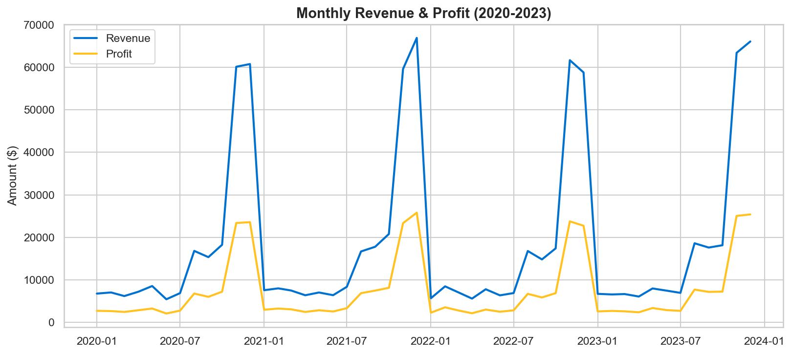
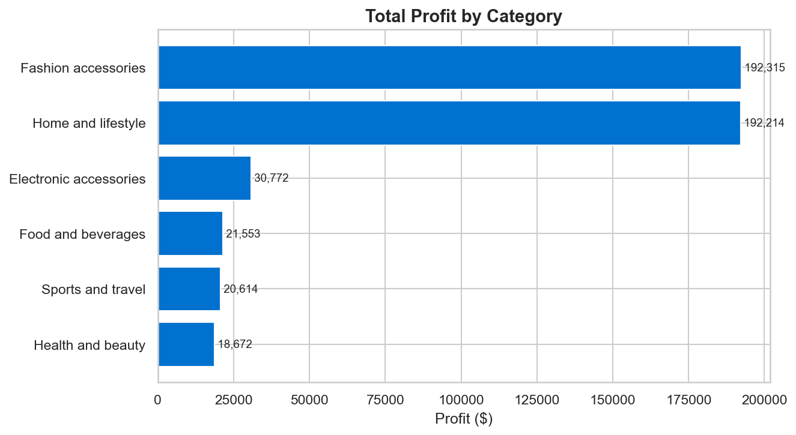
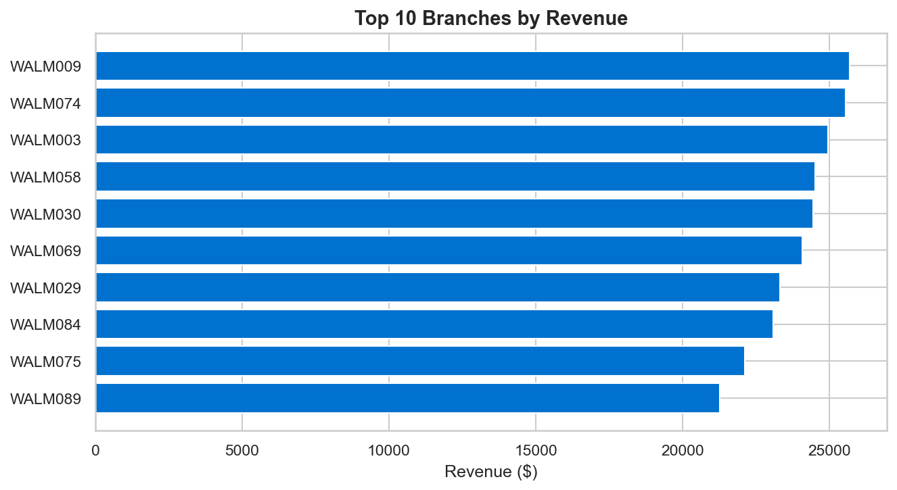
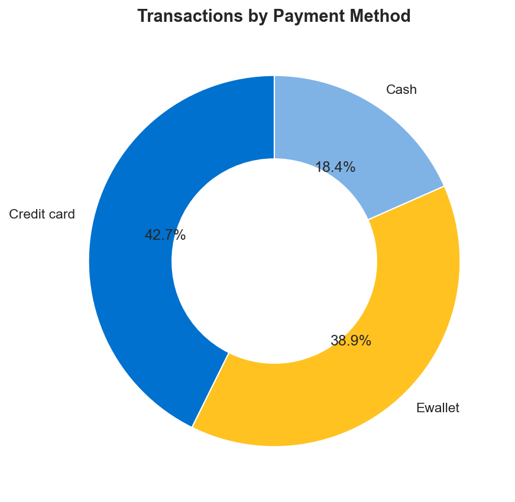
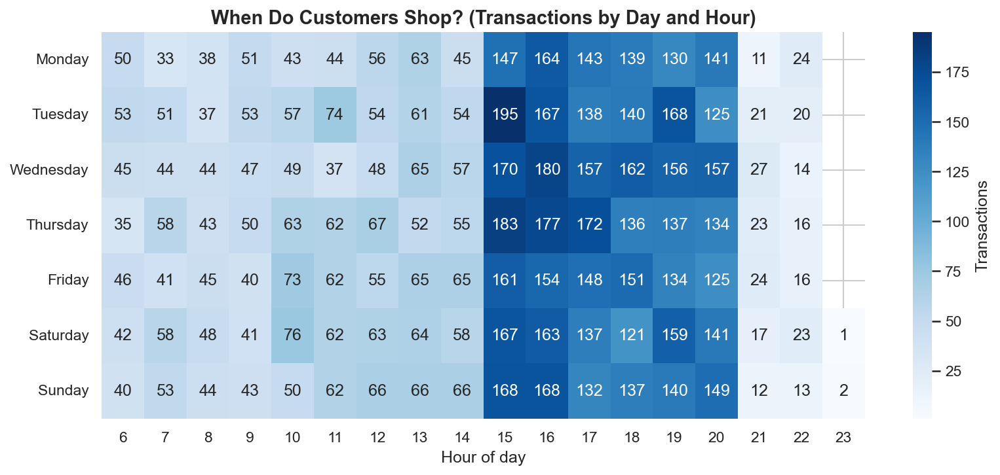
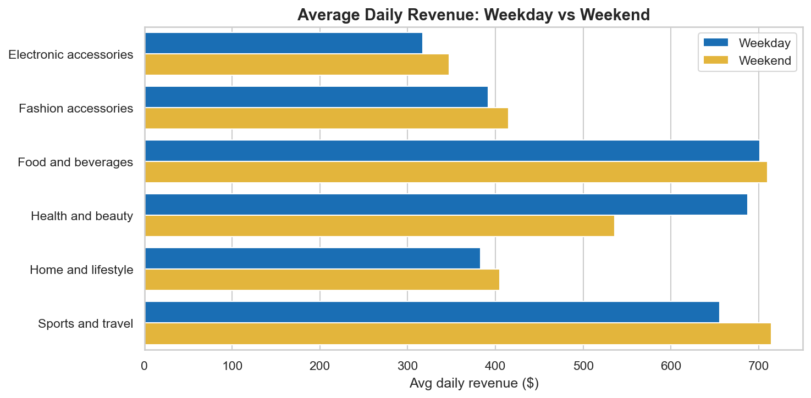
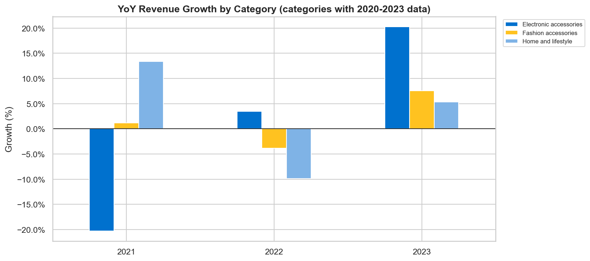
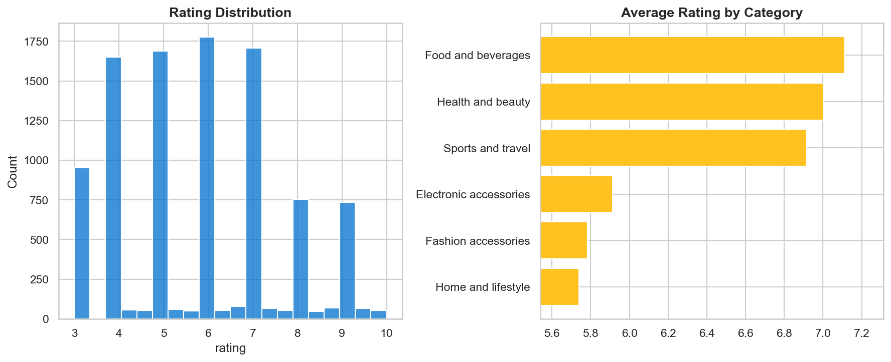

# Walmart Sales Analysis (Python + MySQL)

An end-to-end analysis of ~10,000 Walmart retail transactions. I cleaned the raw data in **Python (pandas)**, loaded it into **MySQL**, answered business questions with **SQL**, and visualised the results with **matplotlib/seaborn**.

## Business Questions
The project answers questions a retail manager would ask:
- Which payment methods do customers use most, and how much do they buy with each?
- Which product category is rated highest in each branch?
- What is the busiest day for each branch?
- Which categories earn the most profit?
- When do customers shop (morning, afternoon or evening)?
- Which branches saw the biggest revenue drop from 2022 to 2023?

## Dataset
- **Source:** Walmart 10K sales dataset (`walmart_dataset/Walmart.csv`)
- **Size:** 10,051 raw rows and 11 columns, covering Jan 2019 to Dec 2023
- **Columns:** invoice_id, branch, city, category, unit_price, quantity, date, time, payment_method, rating, profit_margin
- **Added column:** `total` = unit_price × quantity

## Tools
Python (pandas, SQLAlchemy, PyMySQL, python-dotenv, matplotlib, seaborn) · MySQL · Jupyter Notebook · Git/GitHub

## Workflow
1. **Load** the raw CSV (10,051 rows).
2. **Clean** the data:
   - removed 51 duplicate rows (leaving 10,000)
   - dropped 31 rows with missing `unit_price` and `quantity` (leaving 9,969)
   - removed the `$` sign from `unit_price` and converted it to a number
   - converted `quantity` to an integer
3. **Feature engineering:** created `total` (revenue per transaction), then saved the result as `walmart_clean_data.csv`.
4. **Load into MySQL:** connected through SQLAlchemy, with credentials kept in a `.env` file (not uploaded), and wrote 9,969 rows to a `walmart` table.
5. **Analyse with SQL:** window functions (`RANK() OVER`), CTEs, `CASE` statements and date functions in `SQL_queries.sql`.
6. **Visualise:** 8 charts, saved in the `images/` folder.

## Key Results
| Metric | Value |
|---|---|
| Total revenue | $1,209,726 |
| Total profit | $476,139 |
| Overall profit margin | 39.36% |
| Transactions | 9,969 |
| Average rating | 5.83 / 10 |

## Key Insights
- **Two categories drive the business.** *Fashion accessories* and *Home and lifestyle* each bring in about $489K in revenue and about $192K in profit. Together they make up roughly 81% of all revenue.
- **Credit card is the most used payment method** (42.7% of transactions), followed by e-wallet (38.9%) and cash (18.4%).
- **Afternoons are the busiest shift:** 4,636 transactions, against 3,246 in the evening and 2,087 in the morning. The single busiest day-hour slot is **Tuesday at 3 PM**.
- **Ratings differ by category.** *Home and lifestyle* has the lowest average rating (5.74), while *Food and beverages* is the highest (7.11).
- **Revenue is steady year to year,** at about $217K–$233K from 2020 to 2023. Total revenue for 2023 was about 6.8% higher than for 2022.
- **Some branches fell sharply from 2022 to 2023.** The five biggest drops were WALM045 (−62.6%), WALM047 (−58.6%), WALM098 (−57.9%), WALM033 (−55.7%) and WALM081 (−50.7%). These are good candidates for a closer look.

## Visualisations
| | |
|---|---|
|  |  |
|  |  |
|  |  |
|  |  |

## Limitations
- Only **Electronic accessories, Fashion accessories and Home and lifestyle** have data for all five years. *Food and beverages, Health and beauty* and *Sports and travel* appear only in 2019, so year-over-year growth could be charted for just three categories.
- 2019 has about 1,000 transactions, against about 2,200 a year afterwards, so trend charts start from 2020.
- Ratings in this dataset average about 5.8 on a 10-point scale, so they should be treated as indicative rather than precise.

## Project Structure
```
walmart-sales-analysis/
├── project.ipynb              # cleaning, MySQL load, charts
├── SQL_queries.sql            # business-question queries
├── walmart_clean_data.csv     # cleaned dataset
├── walmart_dataset/Walmart.csv  # raw dataset
├── images/                    # chart screenshots
├── .env.example               # template for database settings
└── README.md
```

## How to Run
1. Clone the repo and install the libraries:
   ```bash
   pip install pandas sqlalchemy pymysql python-dotenv matplotlib seaborn
   ```
2. Make sure MySQL is running and create a database called `walmart_db`.
3. Create a `.env` file in the project folder with your own settings:
   ```
   DB_USER=your_mysql_user
   DB_PASSWORD=your_mysql_password
   DB_HOST=localhost
   DB_PORT=3306
   DB_NAME=walmart_db
   ```
4. Run `project.ipynb` from top to bottom. It cleans the data, loads the `walmart` table and saves the charts.
5. Run `SQL_queries.sql` in MySQL Workbench to reproduce the query results.

